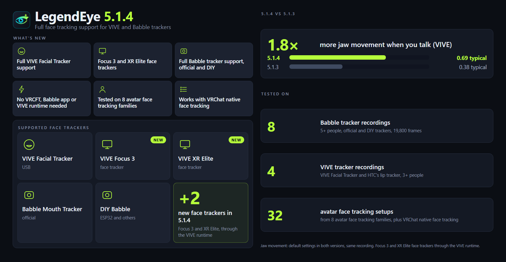
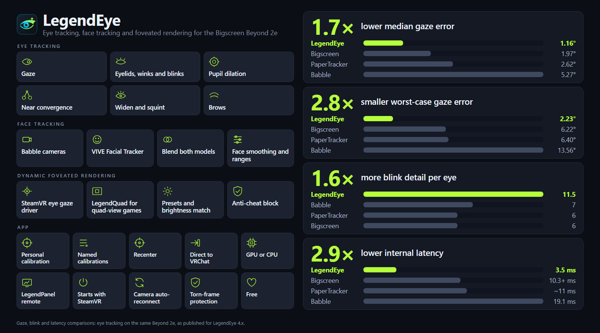
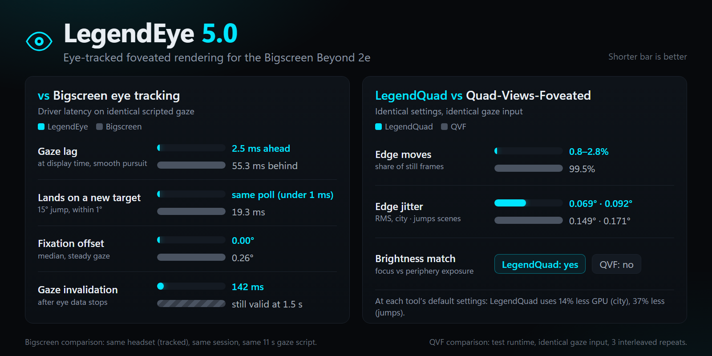

https://github.com/user-attachments/assets/e355732c-f763-4491-8cbc-104bee171a90

https://github.com/user-attachments/assets/6669fe4a-ca21-4385-8b5a-49e3ea01fefb

# LegendEye

Eye tracking, face tracking and dynamic foveated rendering for the **Bigscreen Beyond 2e**. Free to use.

## ⬇️ Download

One file: no installer, nothing to unpack. To update, replace the exe; your settings and calibrations are kept. [All releases](https://github.com/Encapsulation/LegendEye/releases)

**VirusTotal (5.1.9):** [1 of 70 security vendors flagged it](https://www.virustotal.com/gui/file/6c6db4cb8857e03d96a167241d1944a9db3dec63ad9ee41d75dbeacfc3e0a7db)  
SHA256: `6c6db4cb8857e03d96a167241d1944a9db3dec63ad9ee41d75dbeacfc3e0a7db`

The single hit is Trapmine "Suspicious.low.ml.score": a machine-learning guess, not a malware signature. It is triggered by how LegendEye ships: one self-contained EXE with its models and runtime packed inside, which looks unusual to generic scanners. Microsoft Defender and every major antivirus report it clean.

Windows may show "Windows protected your PC" the first time, because the app isn't code-signed yet. Click **More info**, then **Run anyway**.

## What's new in 5.1.9

#### Fixes
- Eye cameras other than the Beyond's own (custom eye trackers): LegendEye now opens the camera at its fastest frame rate. Before, it used the camera's default mode, so a camera that defaults to 30 fps ran at 30 even when it can do 60. The stock Beyond eye cameras already open at their fastest (90 fps) and are unchanged.
- Export logs: the camera log now lists every mode the eye camera offers.

## What's new in 5.1.8

#### Fixes
- Live tab: the eye camera feeds, the drawn eyes and the face preview now update with the camera, up to your monitor's refresh rate. Before, they updated 30 times a second, or 15 when LegendEye was not the focused window.
- Face tab: the face status and model badges no longer grow huge or run past the edge of the card. A long message shows as a short badge with one line of instructions under it.
- VIVE Facial Tracker: recovering from a tracker that stops sending pictures is more reliable. In rare cases LegendEye could crash, or keep the tracker busy, after a stall.
- Eye cameras running at 60 fps: eyelid smoothing always uses the camera's real frame rate. 5.1.7 did not always catch 60 fps cameras.
- Changing a setting and then the camera or source right after no longer restarts tracking with the previous camera.

## What's new in 5.1.7

#### Fixes
- Eye cameras slower than 90 fps (custom eye trackers): blinks were often missed. LegendEye took a blink for a broken camera frame and skipped it, so the eyes stayed open. Blinks now come through.
- Eye cameras slower than 90 fps: eyelid smoothing now runs at the camera's real frame rate. Before, it assumed 90 fps and smoothed about 3 times too much.
- The stock Beyond eye cameras (90 fps) track exactly as before.

## What's new in 5.1.6

#### Fixes
- VIVE Facial Tracker: when the tracker stopped sending pictures, face tracking could stay stopped until LegendEye was restarted. The reopen now always frees the tracker first, so tracking comes back by itself after a few seconds.
- Restarting tracking with a VIVE Facial Tracker no longer waits up to 2 seconds for the tracker to answer.

## What's new in 5.1.5

#### Fixes
- VIVE Facial Tracker: face tracking could stop after a settings change, and stay stopped. LegendEye now pauses before it reopens the tracker, waits longer while the tracker is busy, and tries again if it does not answer.
- When a face camera is open but sends no picture for 3 seconds, LegendEye reopens it by itself. Before, face tracking stayed stopped until you restarted it.
- Changing a setting on the Face tab restarts tracking once. Before, some changes restarted it twice in a row.
- Vive (default) and Babble (default): blank camera frames are skipped. Before, one blank frame could mute the mouth for half a second.
- Export logs: the face camera lines also show unusable frames and camera reopens.

## What's new in 5.1.4

**Full face tracking support for VIVE and Babble trackers.**
- **Vive (default):** full support for the VIVE Facial Tracker, with less delay. The mouth opens fully when you talk.
- **Babble (default):** full support for Babble trackers, official and DIY, with less delay.
- **Focus 3 and XR Elite face trackers** through the VIVE runtime.
- Tested on 8 avatar face tracking families, and works with VRChat native face tracking.
- LegendEye's extras (Remember my face, Face smoothing, picture fixes, calibration) are off by default. Turn off Vive (default) or Babble (default) on the Face tab to use them.
- With either default on, the face is no longer held at rest while the headset is off.

The Babble model does the same job as Babble app, with less delay. If you used Babble app, LegendEye moves you to the Babble model. Close Baballonia so LegendEye can use the camera. Use Babble settings still brings over your crop, smoothing and calibration.

**VIVE app is now VIVE runtime (Focus 3, XR Elite).** It is for:
- Focus 3 and XR Elite face trackers: their lip data only arrives through the VIVE runtime over VIVE Business Streaming. The VIVE model needs the USB VIVE Facial Tracker camera, so for these trackers this source is the only way in.
- Sharing the tracker: if another app needs the VIVE runtime, LegendEye can't take the camera. With this source, both work.

For a VIVE Facial Tracker on its own, use VIVE model.

#### Fixes
- VIVE model: the mouth opens fully when you talk. Part of the jaw value from the tracker was left out.
- VIVE runtime source finds the VIVE runtime's files. Before, it missed them on most setups.
- Face tab: no red "no face camera" flash when switching the face source, and long status text no longer stretches the badges.

## What's new in 5.1.3

#### Fixes
- When SteamVR starts LegendEye, LegendEye now closes when SteamVR closes. Before, it stayed open after SteamVR closed, so Steam still showed SteamVR as running and the next launch failed with "already running". A LegendEye you open yourself stays open.

## What's new in 5.1.2

**Cleaner menus.** Tabs are now Live, Eyes, Lids, Face, Output, DFR, Profiles and Settings, all on one header row as pills, with the same pills for every sub-tab. Output holds VRChat and VRChat avatar (Resonite and ChilloutVR coming). Settings holds App, Performance and Recording. Calibrate and Align share one **Calibrate** button: yellow until you calibrate, green after. Easy and Advanced are in the **Mode** menu.

**USB face cameras work better (DIY and other non-VIVE cameras).**
- Cameras start in their own default mode, the way Babble opens them. A mode that keeps failing is skipped instead of dropping to 2 fps.
- **Camera mode** on the Face tab: Auto, or pick one of the camera's own modes (the best few are listed).
- **Camera picture** on the Face tab: rotate, flip, crop each edge, brightness and contrast, live for every face model and the preview. **Reset picture** puts it back.
- Nothing is taken from Babble's settings by default. Turn on **Use Babble settings** if you want Babble's crop and calibration.
- Virtual cameras open at their fastest frame rate.
- Widen and squint react properly on cameras under 60 fps.

**Live tab.** Bigger eye feeds. The tracking preview sits wide above the face camera, which keeps its real 4:3 shape. Click the preview to cycle stats, mouth zoom, lower face and full head. With face tracking on, it starts in the mouth zoom with the camera. The character and camera pickers are on the Face tab now.

**Face tab.** Two boxes: FACE MODEL (source, a colored model badge and a tracking badge, Find / Browse / More) and CAMERA. Face preview opens docked under the window. Face shapes opens beside it, and only once.

**Face rests with the headset off.** When LegendEye sees the headset is off, face tracking pauses too and the face goes neutral, so the mouth doesn't move from whatever the face camera sees. It starts again when you put the headset back on.

**Experimental: VIVE model on a non-VIVE camera.** Model blend now runs the Babble model alone on USB cameras. Turn on **VIVE model too (test)** to also try the VIVE model on that camera.

**Export logs** now shows the eye camera's listed, arriving and new-picture frame rates, and includes dfr.log, to help with custom trackers.

**Recording.** A **Browse...** button picks the record folder.

#### Fixes
- Readouts no longer show "-+0.00".
- Right after Start, the eye outlines and the tracking preview wait until your eyes are seen, instead of jumping around.
- Windows 3.1 theme: the Face tab's camera buttons and box titles show in full.

## What's new in 5.1.1

**Tracking now starts when you press Start.** LegendEye remembers whether you left tracking on or off and opens the same way next time. After updating it opens stopped once, so press **Start** the first time.

The "Start tracking on launch" switch on the Output tab is gone: Start and Stop are remembered instead.

**SteamVR needs to be running for tracking.** If you press Start with SteamVR closed, LegendEye waits and shows "paused - SteamVR off" until SteamVR starts (with "Pause when headset is off" on, the default).

#### Fixes
- With the face camera set to "both views" on the Live tab, the character and camera buttons stay in view.
- Export logs notes when SteamVR starts, to help track down what launched it.

Updating: replace LegendEye.exe. Your settings and calibrations are kept. If you calibrated with 5.0, press **Retrain expressions** on the Calibrate tab or do a new **Simple** calibration.

## What's new in 5.1

**If you calibrated with 5.0, retrain your expressions.** 5.0's training set up widen with about half its range, so widen could feel weak or hard to trigger. 5.1 trains it correctly. Press **Retrain expressions** on the Calibrate tab (no headset needed, your gaze and blinks stay as they are), or do a new **Simple** calibration.

Your settings and calibrations are kept: just replace LegendEye.exe. If tracking doesn't feel right with your old calibration, do a fresh one: try Simple first.

### Calibration
- Calibrate only your expressions: pick "Only the expressions above" to redo widen, squint and brows in about a minute. Your gaze and blinks stay as they are.
- Retrain expressions: one button on the Calibrate tab sets up widen, squint and brows again from your last calibration's recording. No headset needed, and your gaze and blinks stay as they are.
- Widen and squint steps guide you to open slowly to as wide as you can, and squint slowly to about three quarters.
- The Calibrate tab recommends Simple first, and every user starts 5.1 on the recommended calibration settings. Your spoken instructions and pace choices are kept.
- The Calibrations list shows what each calibration includes (gaze and blinks, or expressions only; widen, squint, brows) and its check result.

### Eye tracking
- Recenter with Space as well as the trigger, for sim racing and other games where your hands are off the controllers.
- Nudge left/right and up/down (Advanced, Filter tab, under Recenter): shift your gaze by a few degrees after the recenter if it's off by the same amount everywhere. 0 by default, and every recenter sets it back to 0.
- Advanced mode shows live widen, squint and brow levels for each eye.
- Tracking rate on the Performance tab: Half tracks every other camera frame for about half the tracking work, for weaker GPUs or tracking on the CPU. Full is the default.

### Face tracking
- Tracking preview (beta): the Live tab can show a drawn face moving with everything LegendEye sends: gaze, lids, widen, squint, brows, pupil size, and with face tracking the jaw, lips, cheeks and tongue. Click the stats tiles to switch between the stats, a close view and the whole face, with the face camera picture beside it if you like. Five characters to pick from.
- Face preview window: the face camera picture (one or both views of the VIVE Facial Tracker) next to the tracking preview (beta).
- Face shapes window: shapes grouped by face region in sections you can open and close. In Both (blend), set how much of each shape comes from the Babble model and how much from the VIVE model, per shape or for a whole region, or leave it on Auto.
- More face filter controls: the jaw on its own, how strongly tiny twitches are held still, and how quickly fast moves show.
- Face smoothing default 0.70 for a steadier jaw, mouth corners and tongue. If you never changed it, 5.1 sets you to 0.70; your own setting is kept.
- Swap tongue left and right: a switch on the Face tab for avatars whose tongue moves to the opposite side.
- The VIVE model can use a network camera address.
- The Face tab tells you when Baballonia is holding the face camera, or when VRCFaceTracking is running alongside LegendEye.
- Find looks for Babble in more places.

### App
- Per-avatar profiles (Profiles tab): link a saved profile to the avatar you are wearing, and LegendEye loads it whenever you change into that avatar. Avatars without a link keep your current settings, and a switch turns it off.
- Lighter: eye tracking uses 107 MB of video memory (263 MB in 5.0), all models with face tracking 287 MB (432 MB), and about half the CPU, with the same tracking. Pupil size and the iris outline run on your GPU too.
- The Live tab shows face tracking frames per second and the slowest 1 % of frame times, which shows stutter an average hides.
- Face models on (Performance tab): run face tracking on a different GPU than eye tracking, or on the CPU. Same as eye tracking by default.
- CPU cores and CPU priority (Performance tab): choose which cores LegendEye runs on and its priority, to experiment with. Defaults are unchanged.
- Integrated GPUs work without extra memory set aside in the BIOS or graphics software; eye tracking uses about 75 MB there. In our tests a dedicated GPU was still faster and used less CPU (RTX 5090 vs the Ryzen 7 7800X3D's Radeon graphics), so the CPU and integrated GPU choices are marked experimental. Your PC may differ: try them and keep what works best.
- When the eye cameras won't start, LegendEye names the apps that may be using them (the Bigscreen Beyond Utility's eye tracking, Babble, PaperTracker, EyeTrackVR, another LegendEye, or any app Windows lists as using a camera, such as Discord or OBS) and tells you what to close.
- New version notice: when a newer LegendEye is out, an Update button in the top bar pulses to catch your eye and opens the download page. Nothing is downloaded by itself.
- Copy diagnostics (About): a short summary of your setup and what LegendEye is doing, ready to paste into Discord. Nothing personal is included.
- Export logs covers eye cameras and face tracking: camera open and stop events, face camera pictures (optional), what your avatar takes, your GPUs, memory and models, and recent status changes, so most problems can be found from one export.

### Planned
- Support for Resonite and ChilloutVR is planned for a future version.

## Requirements
- Windows 10 or 11 (64-bit)
- Bigscreen Beyond 2e with its eye-tracking cameras
- SteamVR
- Turn off the eye tracking in the Bigscreen driver or software and close any other eye-tracking app. Only one app can use the cameras at a time.
- Optional, for face tracking: a Babble camera or a VIVE Facial Tracker, and the face model from your own Babble or VIVE install

## Getting started
1. Run LegendEye.exe and press **Start**. It talks to VRChat directly (OSC), with no extra software needed.
2. Press **Calibrate**. **Simple** with the default settings is recommended: widen and squint on, short brows, extra blinks off. Follow the voice: keep your head still and follow the dot with your eyes. It takes about 4 minutes, then your personal eye model trains. Training is much faster with SteamVR and VR games closed.
3. Optional: let LegendEye start with SteamVR. It then waits in the tray, ready whenever you are.

> Check the eye camera feeds in LegendEye before each session. The white glow near the edges is normal; dust, skin, and other contamination and debris near the center can cause issues, especially during calibration. If the center isn't clear, a lens puffer brush works best. Otherwise wipe gently with the included microfiber cloth; for stubborn debris, wrap the cloth over a blunted toothpick. Never use liquids or cleaning agents.

## Features
### Eye tracking
- Gaze, eyelids (with winks and blinks) and pupil size for any VRChat avatar with eye tracking
- Widen, squint and brows, set up for your eyes in your calibration, each with its own switch, sensitivity, start point and output range
- Recenter with the trigger or Space, plus a small nudge if your gaze is off by the same amount everywhere
- Closed eyes stay closed, and frowning or squinting pulls your gaze off much less

### Calibration
- A head-still calibration that personalizes the eye model to you: Simple, or Advanced with paths fitted to your gaze range
- Named calibrations: every calibration is kept, and you can switch, rename or delete them
- Expressions-only calibration and Retrain expressions, to redo widen, squint and brows without a full calibration
- Recenter with 1 or 5 dots, offered when you put the headset on
- Field of view check: how far your eyes turn and what each eye sees, as a report

### Face tracking
- The VIVE Facial Tracker, VIVE Focus 3 and XR Elite face trackers (through the VIVE runtime), and Babble trackers, official and DIY
- The VIVE model, the Babble model, or both blended (experimental)
- Tested on 8 avatar face tracking families, and works with VRChat native face tracking
- Face smoothing, and the range and maximum sent for every face shape, grouped by face region, with a per-shape Babble / VIVE mix in Both
- Face camera preview and a live tracking preview (beta) with five characters
- Sends to VRChat directly, through VRCFaceTracking, or to other apps

### Dynamic foveated rendering (DFR)
- LegendEye's own SteamVR driver sends your gaze to games with built-in eye-tracked foveated rendering
- LegendQuad adds eye-tracked foveated rendering to games that support quad views, such as DCS World, with presets and brightness match
- LegendQuad blocks games with Easy Anti-Cheat or BattlEye unless you choose Allow anyway; it is recommended for single-player or offline games

### App
- Works with [LegendPanel](https://github.com/Encapsulation/LegendPanel), a VR performance panel that can also control LegendEye from inside VR
- Settings profiles, per-avatar profiles that load when you change avatars, and a Reset button on every settings card
- Easy mode with live readouts; Advanced mode with filters, per-eye lid tuning, eye movement scale and limit, near convergence, and pupil size and reaction
- Closes the avatar's eyes when the headset is taken off, and pauses when SteamVR closes
- Camera reconnects by itself after a USB drop, skips torn frames, and warns about a dirty lens
- Runs on the GPU by default (DirectML: NVIDIA, AMD or Intel), with automatic CPU fallback
- Export logs makes a report zip for problems, with an optional calibration report

## Using LegendEye with VRCFaceTracking (VRCFT)
LegendEye does face tracking itself now (see Features). If you prefer to keep running a mouth tracker such as Babble through VRCFaceTracking (VRCFT), install the LegendEye VRCFT module, so VRCFT combines LegendEye's eyes with Babble's mouth. VRChat accepts only one face tracking message at a time: without the module, the two overwrite each other.
1. Download `LegendEye-VRCFT-Module-1.1.0.zip` from the [module release](https://github.com/Encapsulation/LegendEye/releases/tag/vrcft-module-1.1.0) and install it in VRCFT: **Module Registry**, then the **Install from .zip** button next to the search box. Avatars set up for VRChat's native face tracking need a VRCFT version that sends it.
2. In LegendEye, click **Advanced** (top right), open the **Output** tab, and in the **VRChat** box set **OSC port** to `9400` and **Native face** to **Always**.
3. In VRCFT, uninstall or disable **Bigscreen's Beyond module** (it would take the eyes), and keep **LegendEye above Babble** in the module list. In Babble, turn its own eye tracking off. VRCFT's log shows whether LegendEye data arrives.
4. Start LegendEye, Babble and VRCFT. Eyes, blinks and pupils come from LegendEye, the mouth from Babble. VRCFT adds about 6 ms; without a mouth tracker, keep the normal setup (no module) for the lowest latency.

## Help
- Report problems at [Issues](https://github.com/Encapsulation/LegendEye/issues). In the app, click **About** and then **Export logs**, and attach the zip.

## License
Free to use; all rights reserved. See LICENSE.txt. Third-party components are listed in THIRD_PARTY_NOTICES.txt.

## Star History
<a href="https://www.star-history.com/#Encapsulation/LegendEye&Date">
  <picture>
    <source media="(prefers-color-scheme: dark)" srcset="https://api.star-history.com/svg?repos=Encapsulation/LegendEye&type=Date&theme=dark" />
    <source media="(prefers-color-scheme: light)" srcset="https://api.star-history.com/svg?repos=Encapsulation/LegendEye&type=Date" />
    
  </picture>
</a>
