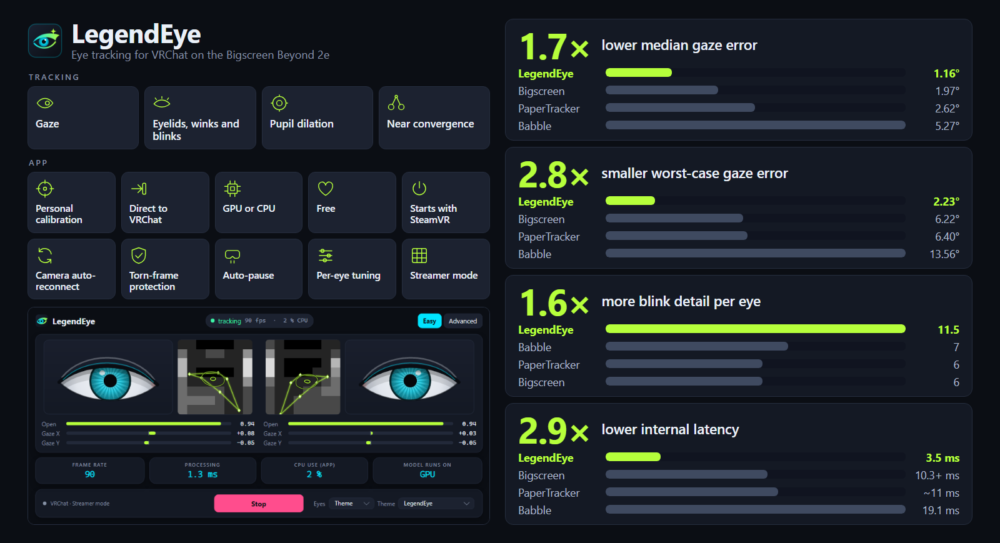

# LegendEye

Eye tracking for VRChat on the **Bigscreen Beyond 2e**. Free to use.

## Download
Get **LegendEye.exe** from the [latest release](https://github.com/Encapsulation/LegendEye/releases/latest). It's a single file: no installer, nothing to unpack.

> Windows may show "Windows protected your PC" the first time, because the app isn't code-signed yet. Click **More info**, then **Run anyway**.

> **VirusTotal:** [0 of 55 security vendors flagged it](https://www.virustotal.com/gui/file/145eea622a7467aee66dcda51d882ad13914f4a1a01fca545eb78fb694e057a9).  
> SHA256: `145eea622a7467aee66dcda51d882ad13914f4a1a01fca545eb78fb694e057a9`

## Requirements
- Windows 10 or 11 (64-bit)
- Bigscreen Beyond 2e with its eye-tracking cameras
- SteamVR
- Turn off the eye tracking in the Bigscreen driver or software and close any other eye-tracking app. Only one app can use the cameras at a time.

## Getting started
1. Run LegendEye.exe and press **Start**. It talks to VRChat directly (OSC), with no extra software needed.
2. Press **Calibrate** and follow the voice: keep your head still and follow the dot with your eyes. It takes about 2 minutes. Your personal eye model is saved and used from then on.
3. Optional: let LegendEye start with SteamVR. It then waits in the tray, ready whenever you are.

## Features
- Gaze, eyelids (with winks and blinks) and pupil size for any VRChat avatar with eye tracking
- A 2-minute, head-still calibration that personalizes the eye model to you
- Easy mode with live readouts; Advanced mode with filters, per-eye lid tuning (closed / open levels), horizontal and vertical eye movement scale and limit, and the avatar's pupil size and reaction
- Closes the avatar's eyes when the headset is taken off
- Dirty-lens warning
- Runs on the GPU by default (DirectML: NVIDIA, AMD or Intel), with automatic CPU fallback

## Help
- Report problems at [Issues](https://github.com/Encapsulation/LegendEye/issues). In the app, click **About** and then **Export logs**, and attach the zip.

## License
Free to use; all rights reserved. See LICENSE.txt. Third-party components are listed in THIRD_PARTY_NOTICES.txt.
